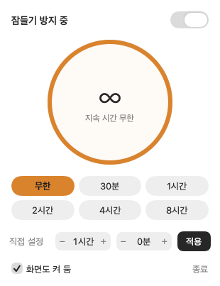
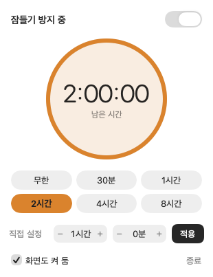
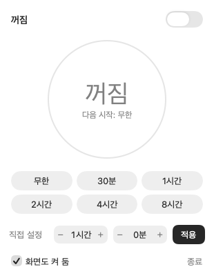

# WakeUp

맥이 잠들지 않게 지켜 주는 가벼운 메뉴바 앱입니다.

앱을 켜면 바로 잠들기 방지가 시작되고, 지속 시간은 기본값인 **무한**입니다. 필요하면 30분, 2시간처럼 시간을 정해 두고 그 시간이 지나면 자동으로 꺼지게 할 수 있습니다.

| 켜짐 (무한) | 켜짐 (시간제한) | 꺼짐 |
|---|---|---|
|  |  |  |

## 이런 때 쓰세요

- 오래 걸리는 빌드, 렌더링, 다운로드를 돌려 두었을 때
- 발표나 화상회의 중에 화면이 꺼지면 곤란할 때
- 모니터링 화면을 계속 켜 두어야 할 때

## 주요 기능

- **실행 즉시 켜짐:** 앱을 열면 바로 잠들기 방지가 시작됩니다. 기본 지속 시간은 무한입니다.
- **시간 설정:** 프리셋(무한, 30분, 1시간, 2시간, 4시간, 8시간)이나 직접 설정(시간 0~99, 분 5분 단위)으로 고릅니다.
- **자동 해제:** 정한 시간이 지나면 저절로 꺼집니다. 남은 시간은 팝오버의 링과 메뉴바에서 볼 수 있습니다.
- **상태가 보이는 아이콘:** 메뉴바의 불꽃 아이콘이 상태를 알려 줍니다.
  - 꽉 찬 불꽃: 켜짐(무한)
  - 아래에서부터 차 있는 불꽃: 시간제한 중 (시간이 줄수록 낮아지고, 옆에 남은 시간이 표시됩니다)
  - 점선 불꽃: 꺼짐
- **화면 유지 옵션:** 시스템 잠들기뿐 아니라 화면 꺼짐도 막습니다. 팝오버에서 끌 수 있습니다.
- **Dock 아이콘 없음:** 메뉴바에만 상주합니다.
- 라이트/다크 모드를 자동으로 따릅니다.

## 설치

### 필요한 것

- macOS 13 (Ventura) 이상
- Xcode Command Line Tools (Xcode 전체는 필요 없습니다)

```bash
xcode-select --install
```

### 빌드와 설치

```bash
git clone https://github.com/ecarusblue/wakeup_mac.git
cd wakeup_mac
./build.sh
./install.sh
```

- `./build.sh`: 앱 아이콘을 만들고 `build.noindex/WakeUp.app`을 빌드합니다.
- `./install.sh`: 빌드한 앱을 `/Applications`에 설치합니다. 이미 실행 중이면 종료한 뒤 교체합니다.

설치 없이 빌드한 앱만 실행해 보려면 다음처럼 합니다.

```bash
open build.noindex/WakeUp.app
```

> 빌드 폴더 이름이 `build.noindex`인 이유: Spotlight와 Launchpad가 빌드 결과물을 앱으로 인식해 중복 표시하는 것을 막기 위해서입니다.

## 사용법

1. Launchpad나 응용프로그램 폴더에서 **WakeUp**을 엽니다. Dock에는 뜨지 않고 메뉴바에 불꽃 아이콘이 나타나며, 바로 잠들기 방지가 켜집니다.
2. 메뉴바의 불꽃 아이콘을 누르면 팝오버가 열립니다.
3. 팝오버에서 다음을 할 수 있습니다.

| 하고 싶은 일 | 방법 |
|---|---|
| 켜고 끄기 | 오른쪽 위 스위치 |
| 시간 정하기 | 프리셋 칩(무한, 30분, 1시간, 2시간, 4시간, 8시간) 선택 |
| 원하는 시간으로 설정 | "직접 설정"에서 시간과 분을 고르고 **적용** |
| 화면도 켜 둘지 선택 | 하단의 "화면도 켜 둠" 체크 |
| 앱 종료 | 하단의 **종료** |

- 끈 뒤 다시 켜면 마지막으로 고른 시간으로 시작합니다.
- 앱을 다시 실행하면 지속 시간은 항상 **무한**으로 시작합니다. ("화면도 켜 둠" 설정만 기억합니다.)
- 앱을 종료하면 잠들기 방지도 함께 해제됩니다.

### 동작 확인

잠들기 방지가 실제로 걸려 있는지는 터미널에서 확인할 수 있습니다.

```bash
pmset -g assertions | grep WakeUp
```

켜져 있으면 `WakeUp keeping Mac awake`라는 이름의 항목이 보입니다.

## 알아 두세요

- **덮개를 닫으면 잠들 수 있습니다.** macOS의 정책이라 일반 앱이 막을 수 없습니다.
- 배터리로 쓰는 중에 오래 켜 두면 배터리가 빨리 닳을 수 있습니다.
- 직접 빌드한 앱은 임시 서명(ad-hoc)이라 다른 Mac으로 옮겨 쓰려면 별도의 서명과 공증이 필요합니다.
- 네트워크 접근이나 데이터 수집은 없고, 별도 권한 요청도 없습니다.

## 동작 원리

macOS의 전원 어서션(`IOPMAssertionCreateWithName`)을 사용합니다.

- 시스템 잠들기 방지: `PreventUserIdleSystemSleep`
- 화면 꺼짐 방지: `PreventUserIdleDisplaySleep`

어서션은 앱 프로세스에 묶여 있어서, 앱이 갑자기 종료돼도 macOS가 자동으로 해제합니다.

## 프로젝트 구조

```
Sources/
  WakeUpApp.swift     메뉴바 앱 진입점
  SleepGuard.swift    전원 어서션, 타이머, 남은 시간 계산
  ContentView.swift   팝오버 UI (링, 프리셋 칩, 직접 설정)
  Theme.swift         색상과 메뉴바 불꽃 아이콘 그리기
tools/make_icon.swift 앱 아이콘(.icns) 생성기
design/               디자인 시안과 화면 캡처
build.sh              빌드 스크립트
install.sh            /Applications 설치 스크립트
PRD.md                제품 요구사항 문서
```

## 문서

- [PRD.md](PRD.md): 목표, 기능 요구사항, UX, QA 체크리스트, 로드맵
- [design/mockup.html](design/mockup.html): 디자인 시안 (브라우저에서 열면 상호작용해 볼 수 있습니다)
